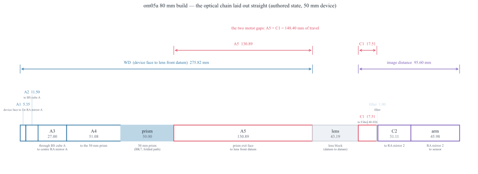
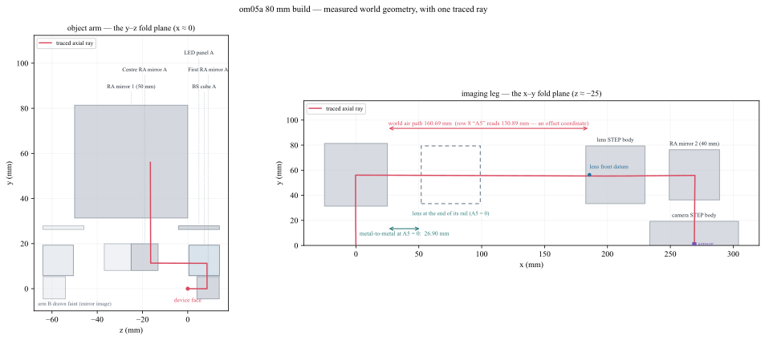
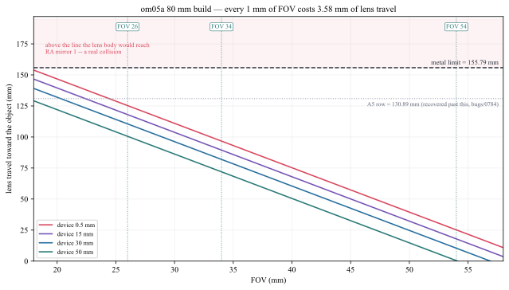

Folded Bench Geometry — Working Distance and Lens Travel
========================================================

Folded imaging benches use mirrors or prisms to fit a long optical path
into a compact mechanical envelope. This example uses a two-arm inspection
layout to distinguish path length, optical conjugates, working distance,
and available mechanical travel.

The figures describe one example geometry. Their dimensions and calculated
curves are specific to that layout and are not general component limits.

Unfold the path first
---------------------

Follow the chief ray through every interface and record the physical length,
medium, and fold direction of each segment. A prescription's station
coordinate may differ from a distance measured between mechanical faces.

Keep these quantities separate:

* Physical path length along the traced ray.
* Optical path length :math:`\sum_i n_i d_i`.
* Paraxial propagation distance in the chosen ray convention.
* Straight-line clearance between mechanical bodies.

Working distance needs a reference
----------------------------------

State whether working distance is measured from a lens vertex, front
housing face, or another datum. Principal-plane object distance is an
optical quantity and generally differs from this mechanical distance.

A zero nominal gap in an unfolded prescription does not prove that two
physical bodies touch. Inspect the transformed body positions and the
nearest relevant faces.

Lens travel and field of view
-----------------------------

For a fixed sensor width :math:`w_s` and object field width :math:`w_o`,
the magnification magnitude is

.. math::

   |m|=\frac{w_s}{w_o}.

For a thin equivalent lens in air, with positive real conjugate distances,

.. math::

   s=f\left(1+\frac{1}{|m|}\right),
   \qquad s'=f(1+|m|).

Use these relations as a first-order check. A real multi-element assembly
also requires principal-plane positions, clearances, and a focus condition.

If two air gaps are labelled A5 and C1, moving a fixed lens group between
fixed surrounding components increases one gap while decreasing the other.
Their available sum sets a travel budget only after lens length, mount
envelopes, collision clearances, and stage limits have been included.

Review checklist
----------------

#. Specify the object field, sensor size, spectrum, and focus criterion.
#. Trace the nominal path and verify each fold.
#. Compare principal-plane conjugates with measured mechanical datums.
#. Check the complete lens and stage envelopes over the required travel.
#. Evaluate vignetting at every field and travel extreme.
#. Trace unwanted cross-arm and ghost paths.
#. Compare ray-count statistics with power-weighted stray-light quantities.

See :doc:`eol_imaging_qualification/index` for the bench acceptance workflow
and :doc:`coaxial_led_dark_edges` for folded illumination.
