Rules of Thumb — Optics, Imaging, Laser
=======================================

A reference of quick-recall formulas and the geometry behind them. Each rule
pairs an illustration with a back-of-envelope estimate. Python examples use
explicit numerical inputs and can be adapted to a measured or modelled system.

.. contents::
   :local:
   :depth: 2

How to use this page
--------------------

Each section uses the same structure:

* **Rule** — the formula in its everyday form.
* **Where each symbol comes from** — variable list pulled out of the equation.
* **Quick number** — a worked example you can do in your head, sized so
  the right-hand side is obviously the right order of magnitude.
* **Numerical check** — a calculation that makes the approximation and its
  input units explicit.

Section 1 — Geometric / paraxial optics
---------------------------------------

1.1 Thin-lens imaging equation
~~~~~~~~~~~~~~~~~~~~~~~~~~~~~~

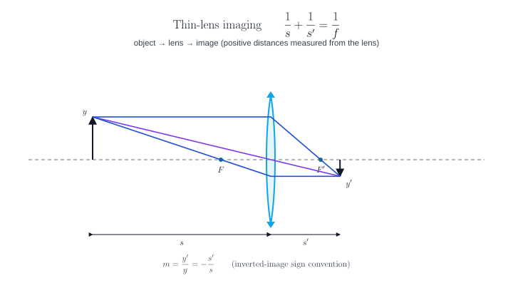

.. math::

   \frac{1}{s} + \frac{1}{s'} = \frac{1}{f}\,,\qquad m = \frac{y'}{y} = -\frac{s'}{s}.

where:

* :math:`s` — object distance, lens to object (positive when the object is
  on the incoming side).
* :math:`s'` — image distance, lens to image.
* :math:`f` — effective focal length.
* :math:`y, y'` — object and image heights.
* :math:`m` — lateral magnification (negative for inverted).

**Quick number.** A 50 mm lens at :math:`s = 250\,\mathrm{mm}` gives
:math:`s' = 1/(1/50 - 1/250) = 62.5\,\mathrm{mm}` and
:math:`m = -62.5/250 = -0.25\times`.

.. code-block:: python

   object_distance_mm = 250.0
   focal_length_mm = 50.0
   image_distance_mm = 1.0 / (1.0 / focal_length_mm - 1.0 / object_distance_mm)
   magnification = -image_distance_mm / object_distance_mm
   print(image_distance_mm, magnification)

1.2 f-number, aperture cone and diffraction limit
~~~~~~~~~~~~~~~~~~~~~~~~~~~~~~~~~~~~~~~~~~~~~~~~~

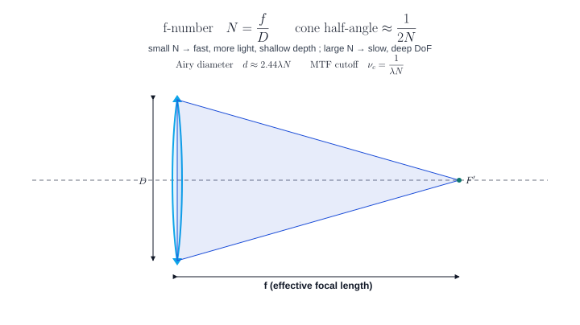

.. math::

   N = \frac{f}{D_{\mathrm{EP}}}\,,\qquad
   d_{\mathrm{Airy}} = 2.44\,\lambda\,N\,,\qquad
   \nu_c = \frac{1}{\lambda\,N}.

where:

* :math:`N` — f-number (a.k.a. "f/N", "speed").
* :math:`D_{\mathrm{EP}}` — entrance-pupil diameter.
* :math:`d_{\mathrm{Airy}}` — diameter of the Airy disk to the first zero.
* :math:`\nu_c` — diffraction-limited MTF cutoff frequency (1/length).

**Quick numbers (λ = 0.55 µm).**

============  ===============  ==============
   N           Airy diameter    MTF cutoff
============  ===============  ==============
f/2            2.7 µm           1660 cyc/mm
f/4            5.4 µm            830 cyc/mm
f/8           10.7 µm            415 cyc/mm
f/16          21.5 µm            207 cyc/mm
============  ===============  ==============

.. code-block:: python

   entrance_pupil_diameter_mm = 12.5
   focal_length_mm = 50.0
   f_number = focal_length_mm / entrance_pupil_diameter_mm
   wavelength_um = 0.55
   airy_diameter_um = 2.44 * wavelength_um * f_number
   cutoff_cycles_per_mm = 1000.0 / (wavelength_um * f_number)

1.3 Working f-number for finite conjugates
~~~~~~~~~~~~~~~~~~~~~~~~~~~~~~~~~~~~~~~~~~

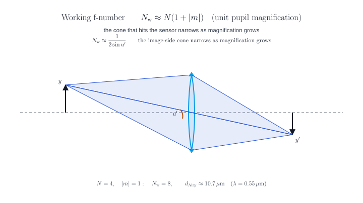

.. math::

   N_w \approx N\,(1 + |m|)
   \quad\text{(unit pupil magnification)}.

where:

* :math:`N_w` — working f-number that actually sets the image-side cone.
* :math:`m` — magnification of the imaging conjugate in use.

**Quick number.** A 100 mm f/4 lens used at 1:1 macro
(:math:`|m| = 1`) acts like :math:`N_w = 8`. The Airy diameter doubles
relative to the nominal f/4 value.

.. code-block:: python

   magnification_magnitude = 1.0
   nominal_f_number = 4.0
   working_f_number = nominal_f_number * (1.0 + magnification_magnitude)
   airy_diameter_um = 2.44 * 0.55 * working_f_number

1.4 Two thin lenses in series
~~~~~~~~~~~~~~~~~~~~~~~~~~~~~

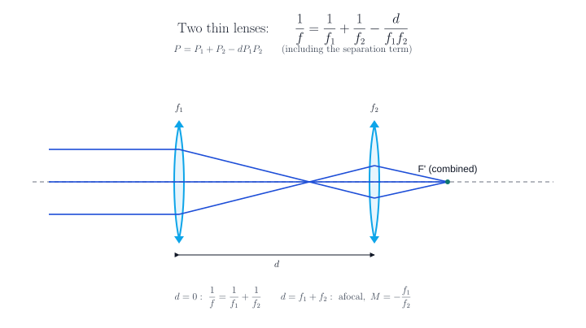

.. math::

   \frac{1}{f} = \frac{1}{f_1} + \frac{1}{f_2} - \frac{d}{f_1 f_2}\,,\qquad
   P = P_1 + P_2 - d\,P_1 P_2.

where:

* :math:`f_1, f_2` — individual focal lengths.
* :math:`d` — separation between the two thin-lens vertices.
* :math:`P_i = 1/f_i` — surface or element powers.

**Quick number.** Two 100 mm lenses spaced 50 mm apart:
:math:`P = 0.01 + 0.01 - 50/10000 = 0.015\,\mathrm{mm}^{-1}`
→ :math:`f \approx 66.7\,\mathrm{mm}` and the doublet is faster than
either element alone.

**Afocal limit.** When :math:`d = f_1 + f_2` the system becomes an afocal
telescope with angular magnification :math:`M = -f_1/f_2`.

.. code-block:: python

   def combined_focal_length(first_focal_mm, second_focal_mm, separation_mm):
       power_per_mm = (1.0 / first_focal_mm + 1.0 / second_focal_mm
                       - separation_mm / (first_focal_mm * second_focal_mm))
       return 1.0 / power_per_mm

   print(combined_focal_length(100.0, 100.0, 50.0))

1.5 Macro 2f rule (1:1 imaging)
~~~~~~~~~~~~~~~~~~~~~~~~~~~~~~~

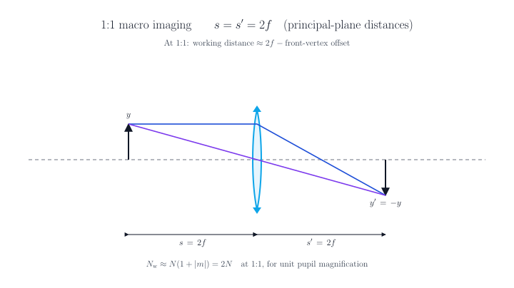

.. math::

   s = s' = 2f\,,\qquad
   \text{W.D.} \approx f\left(1 + \frac{1}{|m|}\right).

where:

* W.D. — working distance, lens-front to object.
* :math:`m` — magnification (1× for unit imaging).

**Quick number.** A 100 mm lens at unit magnification places both object
and sensor 200 mm from the principal planes. Effective f-number doubles
(:math:`N_w = 2N`).

1.6 Snell's law and total internal reflection
~~~~~~~~~~~~~~~~~~~~~~~~~~~~~~~~~~~~~~~~~~~~~

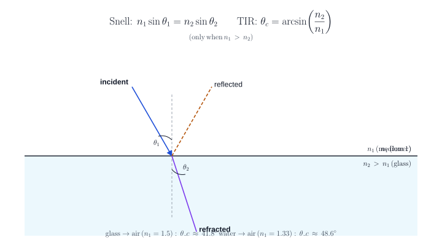

.. math::

   n_1 \sin\theta_1 = n_2 \sin\theta_2\,,\qquad
   \theta_c = \arcsin\!\left(\frac{n_2}{n_1}\right)\;(n_1 > n_2).

where:

* :math:`\theta_1, \theta_2` — incident / refracted angles to the
  surface normal.
* :math:`n_1, n_2` — refractive indices.
* :math:`\theta_c` — critical angle (only defined when :math:`n_1 > n_2`).

**Quick numbers.** glass→air (n=1.50): :math:`\theta_c \approx
41.8^\circ` ; water→air (n=1.33): :math:`\theta_c \approx 48.6^\circ` ;
sapphire→air (n=1.77): :math:`\theta_c \approx 34.4^\circ`.

Section 2 — Imaging system rules
--------------------------------

2.1 Angle of view and sensor format
~~~~~~~~~~~~~~~~~~~~~~~~~~~~~~~~~~~

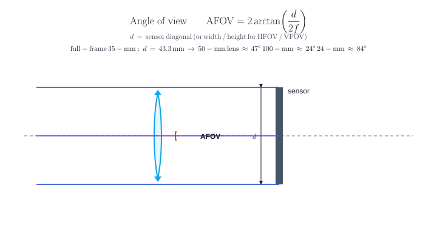

.. math::

   \mathrm{AFOV} = 2 \arctan\!\left(\frac{d}{2f}\right)\,,\qquad
   y' = f\,\tan\theta\;(\text{object at infinity}).

where:

* :math:`d` — sensor full extent (diagonal for full AFOV, width for HFOV,
  height for VFOV).
* :math:`f` — focal length.
* :math:`\theta` — half field angle.
* :math:`y'` — image height of a field point at :math:`\theta`.

**Quick numbers (full-frame 35-mm, d = 43.3 mm).**

============  ==========  ==========
   f           AFOV        H × V
============  ==========  ==========
24 mm          84°         74° × 53°
35 mm          63°         54° × 38°
50 mm          47°         40° × 27°
100 mm         24°         20° × 14°
200 mm         12°         10° × 7°
============  ==========  ==========

2.2 Depth of field
~~~~~~~~~~~~~~~~~~

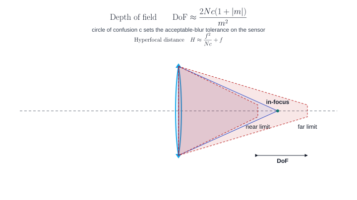

.. math::

   \mathrm{DoF} \approx \frac{2\,N\,c\,(1 + |m|)}{m^2}\quad\text{(general)}\,,\qquad
   \mathrm{DoF} \approx \frac{2\,N\,c}{m^2}\quad\text{(macro, } |m| \ll 1\text{)}.

where:

* :math:`c` — circle of confusion accepted on the sensor (often the
  pixel pitch or 1/1500 of the sensor diagonal).
* :math:`m` — magnification of the in-focus object.
* :math:`N` — f-number.

**Quick number.** Full-frame sensor, :math:`c = 30\,\mu\mathrm{m}`,
f/8, 50 mm at 2 m subject distance gives
:math:`m = 50/1950 \approx 0.026` and
:math:`\mathrm{DoF} \approx 2(8)(0.030)(1.026)/(0.026)^2 \approx 730\,\mathrm{mm}`
— roughly a half-metre in front, a metre behind.

2.3 Hyperfocal distance
~~~~~~~~~~~~~~~~~~~~~~~

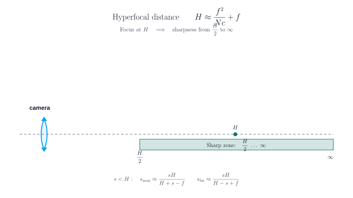

.. math::

   H \approx \frac{f^2}{N\,c} + f.

where:

* :math:`H` — hyperfocal distance. Focusing the lens at :math:`H` makes
  everything from :math:`H/2` to :math:`\infty` acceptably sharp.

**Quick number.** Full-frame 35 mm at f/8, :math:`c = 30\,\mu\mathrm{m}`:
:math:`H = 0.035^2 / (8 \cdot 30\times10^{-6}) + 0.035 \approx 5.14\,\mathrm{m}`.
Set focus to 5 m, get everything from 2.5 m to infinity sharp.

2.4 Diffraction & resolution
~~~~~~~~~~~~~~~~~~~~~~~~~~~~

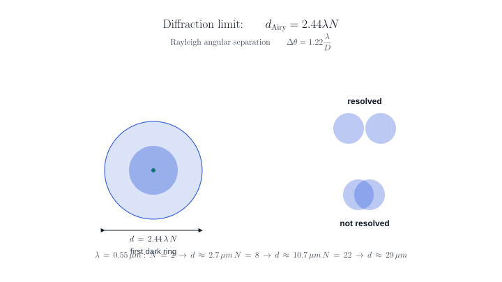

* **Airy disk diameter:** :math:`d = 2.44\,\lambda\,N`.
* **Rayleigh angular resolution:** :math:`\Delta\theta = 1.22\,\lambda/D`.
* **Strehl from RMS wavefront** (small aberration):

  .. math::

     S \approx \exp\!\left(-(2\pi\,\sigma)^2\right)\approx 1 - (2\pi\,\sigma)^2.

  Maréchal's rule:  diffraction-limited iff
  :math:`\sigma \leq \lambda/14\;\;(S \geq 0.8)`.
* **Rayleigh wavefront tolerance:** :math:`\lambda/4` peak-to-valley.

where:

* :math:`D` — entrance-pupil diameter.
* :math:`\sigma` — RMS wavefront error in waves.
* :math:`S` — Strehl ratio (peak intensity / diffraction-limited peak).

.. code-block:: python

   import math
   sigma_waves = 0.05
   strehl_approx = math.exp(-(2*math.pi*sigma_waves)**2)

2.5 Pixel sampling and the Nyquist limit
~~~~~~~~~~~~~~~~~~~~~~~~~~~~~~~~~~~~~~~~

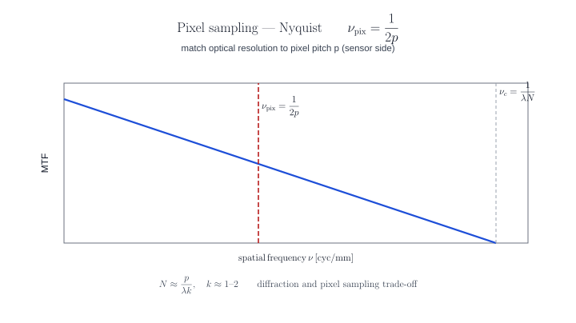

.. math::

   \nu_{\mathrm{pix}} = \frac{1}{2p}\,,\qquad
   \text{match diffraction:}\;\;
   N \approx \frac{p}{\lambda\,k},\;\;k \in [1, 2].

where:

* :math:`p` — pixel pitch on the sensor.
* :math:`\nu_{\mathrm{pix}}` — sensor Nyquist limit.

**Quick number.** A 3.45 µm pixel at λ = 0.55 µm hits a diffraction
limit around :math:`N \approx 3.45 / 0.55 \approx 6.3` for k = 1, i.e.
about f/6.3 — stop down further and the lens, not the sensor, sets
sharpness.

**Bayer/AA caveats.** Color sensors with Bayer filters give effective
luminance Nyquist ≈ 0.7 × geometric Nyquist. If the optical system has
no anti-alias filter, aim for ≥ 2× oversampling at the highest expected
luminance frequency.

Section 3 — Lasers and Gaussian beams
-------------------------------------

3.1 Waist, Rayleigh range, divergence
~~~~~~~~~~~~~~~~~~~~~~~~~~~~~~~~~~~~~

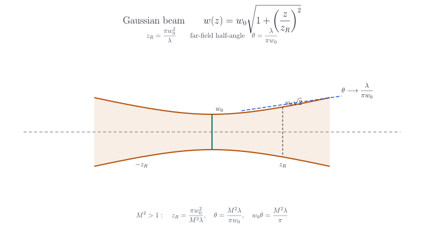

.. math::

   w(z) = w_0\sqrt{1 + (z/z_R)^2}\,,\qquad
   z_R = \frac{\pi\,w_0^2}{\lambda}\,,\qquad
   \theta_{\mathrm{half}} = \frac{\lambda}{\pi w_0}.

where:

* :math:`w_0` — beam waist radius (:math:`1/e^2` of intensity).
* :math:`z_R` — Rayleigh range; beam radius grows by :math:`\sqrt{2}`.
* :math:`\theta_{\mathrm{half}}` — far-field half-angle of the
  :math:`1/e^2` envelope.
* For a beam-quality factor :math:`M^2 > 1` at fixed waist radius and
  wavelength, multiply :math:`\theta` by :math:`M^2` and divide
  :math:`z_R` by :math:`M^2`.

**Quick numbers (λ = 633 nm HeNe).**

==============  ==========  ===============
   w₀            z_R          full-angle 2θ
==============  ==========  ===============
0.10 mm          50 mm        4.0 mrad
0.50 mm         1240 mm       0.81 mrad
1.00 mm         4960 mm       0.40 mrad
==============  ==========  ===============

.. code-block:: python

   import math

   waist_radius_mm = 0.5
   wavelength_mm = 0.633e-3
   rayleigh_range_mm = math.pi * waist_radius_mm**2 / wavelength_mm
   half_divergence_rad = wavelength_mm / (math.pi * waist_radius_mm)

3.2 Focused spot of a Gaussian beam
~~~~~~~~~~~~~~~~~~~~~~~~~~~~~~~~~~~

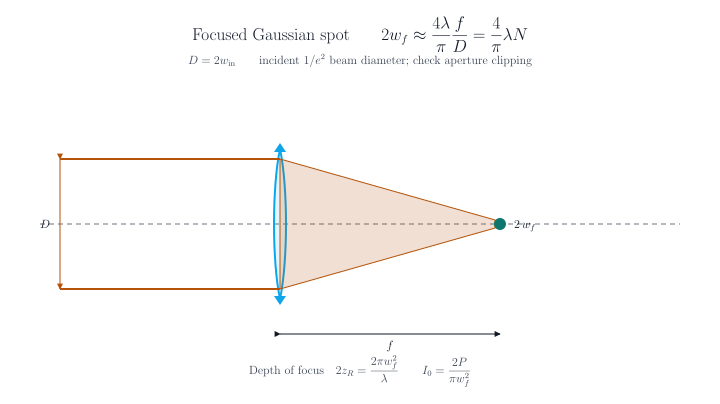

.. math::

   2\,w_f \;\approx\; \frac{4}{\pi}\,\lambda\,N \;=\; \frac{4}{\pi}\,\lambda\,\frac{f}{D}\,,\qquad
   \text{depth of focus}\;\; 2\,z_R = \frac{2\pi\,w_f^2}{\lambda}.

where:

* :math:`w_f` — focused-spot radius at the new waist.
* :math:`D` — incoming-beam diameter at the lens (:math:`2\,w_{\text{in}}`).
* :math:`f` — focal length of the focusing element.

**Quick number.** A 1064 nm beam, 5 mm diameter, focused by a 50 mm
lens: :math:`N = 10` → :math:`2 w_f \approx (4/\pi)(1.064\,\mu)(10) \approx
13.5\,\mu\mathrm{m}`, depth of focus :math:`\approx 0.27\,\mathrm{mm}`.

3.3 Two-mirror cavity stability
~~~~~~~~~~~~~~~~~~~~~~~~~~~~~~~

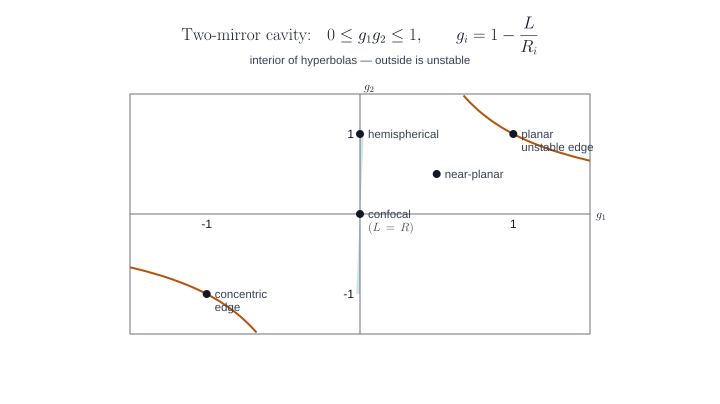

.. math::

   g_i = 1 - \frac{L}{R_i}\,,\qquad
   0 \le g_1\,g_2 \le 1\;\Leftrightarrow\;\text{stable}.

where:

* :math:`L` — mirror-to-mirror cavity length.
* :math:`R_i` — radius of curvature of mirror :math:`i` (positive for
  concave-toward-cavity).

**Special cases.**

* :math:`g_1 = g_2 = 0`: confocal (L = R), lowest waist, large mode.
* :math:`g_1 = g_2 = 1`: planar, only marginally stable.
* :math:`g_1 = g_2 = -1`: concentric (L = 2R), unstable edge.
* :math:`g_1 = 0, g_2 = 1`: hemispherical.

3.4 Power density and damage
~~~~~~~~~~~~~~~~~~~~~~~~~~~~

Peak on-axis intensity at the waist:

.. math::

   I_0 = \frac{2 P}{\pi w^2}.

**Quick number.** 1 mW CW HeNe focused to a 10 µm-radius waist
gives :math:`I_0 = 2(10^{-3})/(\pi \cdot (10\times10^{-6})^2) \approx
6.4\,\mathrm{kW/cm^2}` — well below CW damage thresholds for most
absorbing coatings but enough to permanently bleach a film.

3.5 Coherence and bandwidth
~~~~~~~~~~~~~~~~~~~~~~~~~~~

.. math::

   L_c = \frac{c}{\Delta\nu}\,,\qquad
   \Delta\nu \approx \frac{c\,\Delta\lambda}{\lambda^2}.

* :math:`L_c` — coherence length.
* :math:`\Delta\nu` — optical bandwidth (Hz).
* :math:`\Delta\lambda` — wavelength width (same units as λ).

**Quick numbers.**

* HeNe (Δν = 1.5 GHz):  Lc ≈ 20 cm.
* DBR diode (Δλ = 0.1 nm at 780 nm):  Lc ≈ 6 mm.
* Mode-locked Ti:Sapph (Δλ = 30 nm at 800 nm):  Lc ≈ 21 µm.

Section 4 — Cross-cutting design heuristics
-------------------------------------------

Use these checks when reviewing an optical prescription or a bench measurement.

* **Distinguish full and half extents.** State whether a field is specified
  by diameter, height, semi-height, full angle, or half-angle. Mixing these
  conventions doubles or halves your answers.
* **Stop choice changes pupil location, not focal length.** Move the
  ``STOP`` between elements to change vignetting and pupil aberrations;
  don't expect the focal length, magnification, or image distance to
  change.
* **Paraxial solves are linear**. They assume small angles, no
  decenter/tilt, no aspherics. Use the trace tools, not the calculator,
  for off-axis, anamorphic, or freeform layouts.
* **2/3 rule for image plane motion.** A focus error :math:`\delta` at
  the object side moves the image by :math:`-m^2 \delta` — that's why
  macro setups are so sensitive to subject movement.
* **Don't chase Strehl below 0.8 with paraxial intuition.** Past
  :math:`\sigma \approx \lambda/14`, only the full PSF (Fraunhofer
  propagation of the complex exit-pupil field) tells you what the image
  actually looks like.
* **The achromat is the cheapest fix.** Replacing a singlet with an
  air-spaced doublet cuts on-axis longitudinal chromatic aberration by
  ≈ 30×; a triplet adds another ≈ 5× and removes the spherochromatism
  residual. Quantify the residual with a wavelength-dependent ray or wavefront model.

Section 5 — Where to go next
----------------------------

* :doc:`cardinal_points` — step-by-step ray construction for EP, XP,
  PP, PP', FFL, BFL.
* :doc:`pupil_sampling` — pupil patterns and numerical ray sampling.
* :doc:`aberration_polynomial` — wavefront and ray-aberration polynomials.
* :doc:`worked_exercises/fundamentals_of_photonics/ch03_beam_optics` —
  Gaussian beam optics and worked exercises.
